# APE-LS v2 — AI-Engineered Learning System
## (Math + Python + AI Engineering, Triple-Track Design)

This document outlines the revised architecture, curriculum sequence, adaptive mechanics, and database design for the **AI-Engineered Learning System (APE-LS v2)**.

---

## 1. System Architecture: Triple-Track JIT with Math Micro-Injection

Rather than treating Math, Python, and AI Engineering as isolated courses, APE-LS v2 operates a **concurrent triple-track system**. Every advanced AI Engineering node declares its exact mathematical and programming prerequisites. 

If a learner’s competency score in a prerequisite falls below the required threshold, the system temporarily halts the AI track to perform a **5–10 minute micro-injection lesson** on that specific primitive, resuming the main path immediately after verification.

```mermaid
flowchart TD
    subgraph MATH["Math Track"]
        M0[Algebra & Exponents/Logs]
        M1[Vectors & Dot Product]
        M2[Matrices & Matmul]
        M3[Probability & Sampling]
        M4[Statistics]
        M5[Calculus: Derivatives/Gradient]
        M6[Optimization: Gradient Descent]
        M7[Entropy / Cross-Entropy / KL]
        M8[Attention as Weighted Sum]
    end

    subgraph PY["Python Track"]
        P0[Env Setup, CLI, Git]
        P0b[Vars, Control Flow, Functions]
        P1[Data Structures & JSON]
        P2[Functions, Closures, Decorators]
        P3[Errors & Logging]
        P4[OOP & Dataclasses]
        P5[NumPy]
        P6[Pandas]
        P7[File I/O & Serialization]
        P8[Iterators & Generators]
        P9[Regex & Parsing]
        P10[Async/Await]
        P11[Testing: pytest]
        P12[Packaging & Docker]
    end

    subgraph AI["AI Engineering Track"]
        A1[LLM API Basics]
        A2[Tokenization]
        A3[Prompt Engineering + Structured Output]
        A4[Embeddings in Practice]
        A5[Vector DBs & Retrieval]
        A6[RAG Pipelines]
        A7[Agents & Tool Calling]
        A8[Resilient Prod Pipelines]
        A9[Transformer/Attention Intuition]
        A10[Fine-Tuning / LoRA]
        A11[Evaluation & Observability]
        A12[Deployment & Serving]
        A13[Safety & Guardrails]
        A14[System Design for AI Products]
    end

    M0-->P0b-->A1
    P0-->P0b
    M1-->A4
    P5-->A4
    M2-->A9
    M3-->A2
    A2-->A3-->A4-->A5-->A6-->A7-->A8
    M4-->A11
    M5-->A9
    M5-->A10
    M6-->A10
    M7-->A11
    M8-->A9
    P1-->A1
    P2-->A7
    P3-->A8
    P4-->A6
    P6-->A6
    P7-->A6
    P8-->A6
    P9-->A3
    P10-->A8
    P11-->A11
    P12-->A12
    A9-->A10-->A11-->A12-->A13-->A14
```



---

## 2. Guided Phase Path (Default Pacing Matrix)

| Phase | Math Focus | Python Focus | AI Engineering Focus | Milestone Project (Shippable Portfolio Piece) |
|---|---|---|---|---|
| **0 — Foundations** | Algebra refresher, exponents & logs (foundational for softmax and logprobs). | Env setup (`venv`/`uv`, git, CLI), variables, control flow, functions, string slicing. | What an LLM API call actually is, payload structures. | **"Hello LLM" script:** A CLI client that manages clean prompts, hits the API, and handles simple outputs. |
| **1 — Structuring Data** | Vectors: magnitude, dot product, cosine similarity. | Lists, dictionaries, JSON parsing, basic list comprehensions. | Tokenization mechanics (BPE, context windows), prompt engineering, structured JSON outputs. | **Prompt-Template Engine:** Fills dynamic prompt templates using nested dict datasets and enforces structured JSON-schema responses. |
| **2 — Robustness & Chance** | Matrices & matmul; probability basics (distributions, sampling). | Advanced functions (`*args/**kwargs`, closures, decorators, mutable default bugs), error handling & logging. | Temperature, top-p, and top-k as probability distributions; API rate-limit errors (429), timeouts, and backoffs. | **Resilient API Client Class:** A robust SDK wrapper featuring exponential backoff retries, fallback routing, and structured error logs. |
| **3 — Search & Meaning** | Statistics (mean, variance, standard deviation, correlation). | NumPy fundamentals (vectorized ops, broadcasting, distance functions). | Generating embeddings, computing cosine similarity lists, vector database introductions (Chroma/FAISS). | **Local Semantic Search Engine:** A Python package that indexes, computes cosine similarity, and searches a custom dataset via NumPy and Chroma. |
| **4 — Retrieval Systems** | Calculus basics: derivatives, gradients, chain rule intuition. | File I/O & serialization (JSONL, CSV, Parquet), Pandas fundamentals. | Chunking strategies (character, token, recursive), RAG pipelines, reranking, hybrid keyword/semantic search. | **Production RAG Engine:** A modular retriever preprocessed with Pandas, stored in a local vector database, running custom reranking metrics. |
| **5 — Agents** | Optimization intuition (gradient descent, loss functions, learning rates). | Iterators, generators, regex text parsing. | Token streaming, agent design loops (ReAct pattern), function calling, tool routing. | **Research Assistant Agent:** A tool-calling agent (search + calculator + parser) outputting a live token stream and recording execution traces. |
| **6 — Scale & Concurrency** | Linear algebra for Transformers: softmax, attention weights. | Async/await, `asyncio.gather`, concurrent task loops. | Attention/Transformer architecture intuition, multi-agent frameworks, high-throughput concurrent batch inference. | **Concurrent Batch Processor:** A production-grade async scheduler processing a batch of prompts concurrently while respecting rate limits. |
| **7 — Rigor** | Applied statistics for evaluation metrics. | Unit testing with `pytest`, API mocking. | Fine-tuning/LoRA (PEFT, dataset preparation, compute modeling), evaluation harnesses, LLM-as-a-judge, tracing. | **Evaluation Harness:** A test harness validating agent performance against a golden dataset using stats, with mocked API layers. |
| **8 — Production Capstone** | Quantitative latency vs. cost modeling. | Project structures, dependency locking, Docker basics, CI pipelines. | Wrap FastAPI endpoints, Dockerization, guardrails (prompt injection, PII filters), semantic caching. | **Capstone:** Deployed, dockerized, RAG + Tool-calling agent system monitored with Langfuse-style logging, guarded, and evaluated. |

---

## 3. Math Track — Sequence & Rationale

| Step | Mathematical Concept | Practical AI Engineering Application |
|---|---|---|
| **M0** | Algebra, exponents, logarithms | Understanding model token log-probabilities, converting logprobs to percentages, softmax exponents. |
| **M1** | Vectors, dot product, magnitude, cosine similarity | The mathematical backbone of document search, embedding similarity, and retrieval ranking. |
| **M2** | Matrices, matrix multiplication | Batching operations. Every bulk prompt or batch token matrix multiplication runs on this. |
| **M3** | Probability: distributions, expectations, random variables | Understanding temperature, top-p, top-k, and sampling token choices from the vocabulary distribution. |
| **M4** | Statistics: mean, variance, std, correlation | Benchmarking model latency, computing evaluation metric distributions, prompt evaluation confidence. |
| **M5** | Calculus: derivatives, gradients, chain rule (intuition) | Demystifying backpropagation during training and parameter updates in fine-tuning runs. |
| **M6** | Optimization: gradient descent, loss, learning rate | Tuning fine-tuning hyperparameters (e.g., loss curves, learning rate scheduler decays). |
| **M7** | Information theory: entropy, cross-entropy, perplexity | Evaluating model performance; parsing log-loss, token perplexity, and validation metrics. |
| **M8** | Attention as a weighted sum ($softmax(QK^T)V$) | Understanding the inner workings of self-attention blocks in Transformers when debugging prompt context limits. |

---

## 4. Python Track — Sequence & Rationale

| Step | Python Concept | AI Engineering Application |
|---|---|---|
| **P0** | Environment setup, Git, terminal CLI, virtual envs (`venv`, `uv`) | The base workspace required to run local models, call APIs, and install packages. |
| **P0b** | Variables, control flow, functions, string slicing | Fundamental structures used to build logic, route responses, and slice query strings. |
| **P1** | Lists, dictionaries, JSON parsing, comprehensions | Extracting nested tool-call parameters, system arguments, and LLM JSON-schema payloads. |
| **P2** | Functions, `*args/**kwargs`, closures, decorators, mutable defaults | Designing clean tool registration decorators and performance-tracking hooks. |
| **P3** | Exception handling, structured logging | Catching rate limits, network timeouts, invalid JSON generation, and writing audit trails. |
| **P4** | Object-Oriented Programming, dataclasses | Managing chat histories, session states, configuration wrappers, and agent systems. |
| **P5** | NumPy arrays, broadcasting, vectorized math | Implementing cosine similarity, vector math, distance routing, and embedding operations. |
| **P6** | Pandas DataFrames, merging, group-by ops | Ingesting data sources, cleaning CSVs/Parquet datasets, and preparing validation logs. |
| **P7** | File I/O, serialization (JSONL, Parquet, YAML) | Loading system configurations, writing datasets for fine-tuning, storing prompt histories. |
| **P8** | Iterators & generators | Processing large text corpora without RAM exhaustion; streaming live LLM tokens. |
| **P9** | Regular expressions & text parsing | Extracting code snippets, markdown blocks, and tool arguments from raw LLM strings. |
| **P10** | Async/await, concurrent execution | Scaling inference pipelines. Sequential API processing is too slow for production apps. |
| **P11** | Unit testing (`pytest`), API mocking | Writing robust test suites for agents without executing expensive, non-deterministic LLM calls. |
| **P12** | Packaging, dependency locking, Docker | Creating reproducible builds of agents and hosting them as containers on cloud servers. |

---

## 5. AI Engineering Track — Sequence & Rationale

| Step | Concept | Prerequisite Concepts |
|---|---|---|
| **A1** | LLM API Basics (REST, authentication, streaming endpoints) | `P0b`, `P1`, `M0` |
| **A2** | Tokenization Mechanics (BPE, byte-pair encodings, context budget) | `M3` |
| **A3** | Prompt Engineering (zero/few-shot, tool structures, JSON mode) | `P9`, `A2` |
| **A4** | Embeddings in Practice (generation, similarity metrics) | `M1`, `P5` |
| **A5** | Vector DBs (FAISS, Chroma, metadata parsing, filters) | `A4` |
| **A6** | RAG Pipelines (chunking, hybrid search, semantic retrieval) | `A5`, `P4`, `P6`, `P7`, `P8` |
| **A7** | Agents & Tool Orchestration (ReAct, function calling, state machines) | `P2`, `A3` |
| **A8** | Production Pipelines (circuit breakers, exponential retries, batching) | `P3`, `P10` |
| **A9** | Transformer Intuition (attention layers, hidden states, logits) | `M2`, `M8`, `M5` |
| **A10** | Fine-Tuning & Parameter Tuning (LoRA, PEFT, dataset formatting) | `M5`, `M6`, `A9` |
| **A11** | Evaluation & Observability (golden sets, LLM judges, tracing) | `M4`, `M7`, `P11` |
| **A12** | Deployment & Serving (FastAPI wrappers, caching, latency optimization) | `P12` |
| **A13** | Safety & Guardrails (injection defense, PII masking, safety filters) | `A7`, `A11` |
| **A14** | AI System Design (cost estimation, model selection, architecture) | `A12`, `A13` |

---

## 6. Question Generation Engine Specification

To ensure high-fidelity, non-repetitive generation, the system uses a structured template model. The prompt generator dynamically builds queries utilizing the following schema:

```json
{
  "track": "math | python | ai_engineering | integrated",
  "scenario": "A description of a realistic production task (no puzzle questions)",
  "task_type": "write | debug | complete | refactor | derive | compute",
  "starter_code_or_prompt": "Code block with issues, empty fields, or a mathematical question",
  "solution": "The correct implementation, mathematical expression, or numerical result",
  "check_method": "unit_test | numeric_tolerance | symbolic | keyword_explanation",
  "explanation": "Visual execution trace explaining why this solution works",
  "checks": "Assertion statements, numeric target + tolerance, or required evaluation keywords"
}
```

---

## 7. Repetition & Progression: 4D Variation

Rather than simple repetition, the engine mutates exercises across **four dimensions** when "One more" is requested:

```text
[M1-V1: Compute] ---> Cosine similarity between two vectors, by hand
  |
  +-- [P5-V2: Implement] ---> Same similarity, vectorized in NumPy (Track Bridge)
        |
        +-- [A4-V3: Apply] ---> Rank a set of document embeddings against a query embedding (Scenario Shift)
              |
              +-- [A5-V4: Debug] ---> Fix a bug where results are unsorted because similarity, not distance, was used (Structural Shift)
```

1.  **Scenario Shift:** Swapping domain contexts (e.g., from search retrieval to ranking audio chunks).
2.  **Structural Shift:** Changing the interaction pattern (e.g., from writing code from scratch to locating a bug in existing logic).
3.  **Variable/Schema Mutation:** Modifying data structures, naming conventions, and API responses.
4.  **Track Bridge:** Linking the concept across tracks (Math formulation $\rightarrow$ NumPy translation $\rightarrow$ Production AI implementation).

---

## 8. Taxonomy, Mastery, and Adaptive Difficulty

### Cognitive Taxonomy Tiers
*   **T1: Comprehension (20%):** Tracing execution paths, interpreting mathematical notation, or explaining payload schemas.
*   **T2: Synthesis (30%):** Writing function logic, constructing pipelines, or computing equations by hand.
*   **T3: Debugging (30%):** Finding performance bottlenecks, parsing logic bugs (e.g., mutable defaults), or spotting numerical instability.
*   **T4: Optimization (20%):** Refactoring slow loops into vectorized logic or choosing memory-efficient operations.

### Multi-Score Adaptive Engine
The engine tracks three independent competency scores: $\theta_{\text{math}}$, $\theta_{\text{python}}$, and $\theta_{\text{ai}}$ (ranging from 100 to 1000). 
*   **Prerequisite Gating:** An AI concept will remain locked until the user’s $\theta_{\text{math}}$ and $\theta_{\text{python}}$ meet the target's threshold dependency.
*   **Math Micro-Injection:** If a user fails an AI task due to an underlying mathematical gap, the system pauses to inject a 5-minute math concept check before returning to the AI track.
*   **Feynman exit criteria:** To unlock `Next`, the system prompts for a concise, conceptual explanation mapping math definitions to execution results, scoring based on semantic keyword presence.

---

## 9. Interleaved Spaced Repetition

Review tasks are triggered at intervals of **2 days, 7 days, and 21 days**. Rather than separate quizzes, reviews are dynamically interleaved into the current learning topic:

$$\text{Current Module} + \text{Review Concepts} = \text{Combined Review Challenge}$$

For example:
$$\text{Learning: A6 RAG Pipelines} + \text{Review: M1 Cosine Similarity} + \text{Review: P3 Error Handling}$$
$$\Downarrow$$
$$\text{Task: Write a retrieval function that filters chunks using Cosine Similarity and handles empty database exceptions.}$$

---

## 10. Database Schema (Implementation Base)

```sql
-- User skill metrics across tracks
CREATE TABLE IF NOT EXISTS user_theta (
    track TEXT PRIMARY KEY CHECK(track IN ('math', 'python', 'ai_engineering')),
    theta REAL DEFAULT 300.0
);

-- Concept records and relationship mapping
CREATE TABLE IF NOT EXISTS concepts (
    concept_id TEXT PRIMARY KEY,
    track TEXT CHECK(track IN ('math', 'python', 'ai_engineering')),
    title TEXT NOT NULL,
    min_theta_prereq REAL DEFAULT 300.0
);

-- Concept dependency mapping
CREATE TABLE IF NOT EXISTS concept_dependencies (
    concept_id TEXT,
    requires_concept_id TEXT,
    FOREIGN KEY(concept_id) REFERENCES concepts(concept_id),
    FOREIGN KEY(requires_concept_id) REFERENCES concepts(concept_id)
);

-- Progress tracking and spaced repetition scheduling
CREATE TABLE IF NOT EXISTS user_progress (
    concept_id TEXT PRIMARY KEY,
    mastery_score REAL DEFAULT 0.0,
    attempts_count INTEGER DEFAULT 0,
    last_practiced_at DATETIME DEFAULT CURRENT_TIMESTAMP,
    next_review_at DATETIME,
    FOREIGN KEY(concept_id) REFERENCES concepts(concept_id)
);
```

---

## 11. Capstone & Job-Readiness Layer

To build a hiring-manager-ready portfolio, each phase ends with a milestone task. Every capstone project's `README.md` must explicitly document:
1.  **Math Design Choices:** e.g., justifying cosine similarity vs. inner product.
2.  **Engineering Decisions:** e.g., choosing asynchronous execution over multi-threading for model requests.
3.  **Product Decisions:** e.g., balancing retrieval-generation costs against context window sizing.
