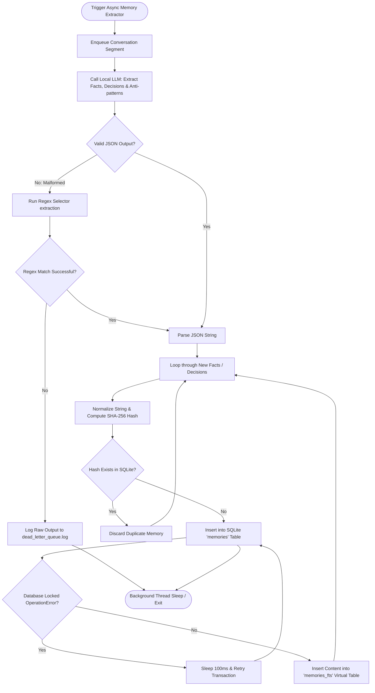

# Personal AI Mentor: Complete System Flow Map

This document contains visual map diagrams illustrating the operational data flows, state machines, and background loops of the Personal AI Mentor.

---

## 1. Main Application Lifecycle & Tag-Based Context Routing

This flowchart maps the execution sequence from the moment you type `python mentor.py` to the printing of a response.

```mermaid
flowchart TD
    Start([1. Start: python mentor.py]) --> SessionId[Generate Session ID & Ping Ollama]
    SessionId --> PingCheck{Ollama Online?}
    
    %% Fail Path
    PingCheck -->|No| OfflineErr[Print Friendly Error & Terminate]
    OfflineErr --> End([End])
    
    %% Success Path
    PingCheck -->|Yes| StartupScreen[Query metrics & Display Daily Startup Screen]
    StartupScreen --> MainLoop[Show Status: Listening]
    
    %% Chat input
    MainLoop --> Input[User Query Input]
    Input --> TagParser[Regex Tag Parser: @technical, @outreach, @career, @hybrid]
    
    %% Routing Decisions
    TagParser -->|Has Tag| RAGFilter[Direct RAG Filter]
    TagParser -->|No Tag| DefaultHybrid[Default to Hybrid RAG Mode]
    
    %% Context Isolation
    RAGFilter -->|@technical| RAGFilterTech[Technical RAG Context]
    RAGFilter -->|@outreach| RAGFilterOutreach[Outreach RAG Context]
    RAGFilter -->|@career| RAGFilterCareer[Career RAG Context]
    RAGFilter -->|@hybrid| RAGFilterHybrid[Hybrid/Global RAG Context]
    DefaultHybrid --> RAGFilterHybrid
    
    %% Read Paths
    RAGFilterTech -->|Query tech notes only| Prompter[System Prompt Builder]
    RAGFilterOutreach -->|Query resume + job logs| Prompter
    RAGFilterCareer -->|Query goals + journal| Prompter
    RAGFilterHybrid -->|Global FTS5 match| Prompter
    
    %% Working Memory loading
    WorkingMem[(SQLite working_memory)] -->|Loaded First| Prompter
    
    %% Synthesize & Generate
    Prompter --> LocalLLM[Local LLM Generation]
    
    %% Output
    LocalLLM --> PrintResponse[Print Response to User Immediately]
    PrintResponse --> TriggerAsync[Spawn Async Memory Extractor Thread]
    TriggerAsync --> MainLoop
```

---

## 2. Asynchronous Memory Update Loop (Background Thread)

This diagram details what happens in the background *after* you receive your response, ensuring latency is not impacted.



---

## 3. SQLite FTS5 BM25 Memory Retrieval Engine (Hybrid Check)

This diagram shows how keywords pull matching contexts from multiple tables simultaneously.

```mermaid
flowchart LR
    Query[User Query: 'LangChain cold email frustration'] --> SearchTokens[Extract Tokens: LangChain, email, frustration]
    SearchTokens --> FTS5Query[SQL SELECT memories_fts MATCH search_tokens]
    
    %% BM25 Scoring
    FTS5Query --> BM25[SQLite BM25 Ranking Engine]
    BM25 --> Sort[Sort by Score DESC]
    Sort --> Limit[Limit to Top 5-10 Results]
    Limit --> Inject[Format into System Prompt Block]
    
    %% Prompt Block Example
    subgraph Global Prompt Block (Cross-Domain Hybrid)
        Inject --> PB["=== RETRIEVED CONTEXT ===
- Category: technical -> LangChain project bullets (Resume table)
- Category: personal_goal -> Wants full-time AI role (Profile table)
- Category: anti_pattern -> Procrastination triggers (Journal table)"]
    end
```

---

## 4. State Transition Matrix

| Current State | Input Action | Next State | Background Actions |
| :--- | :--- | :--- | :--- |
| **Initializing** | Ollama online status checked | **Daily Startup** | Ping localhost:11434; load `working_memory` |
| **Daily Startup** | Display metrics & decisions | **Listening** | Render initial UX screen |
| **Listening** | User types query with `@tag` (or defaults to auto-routing) | **Generating (Selected Mode)** | Query SQLite FTS5 matching tag scope; compile prompt; send to Ollama |
| **Generating** | Answer finished generating | **Listening** | Spawn background thread with segment |
| **Listening** | User types `/resolve <id>` | **Listening** | Update `decisions` set status='resolved' |
